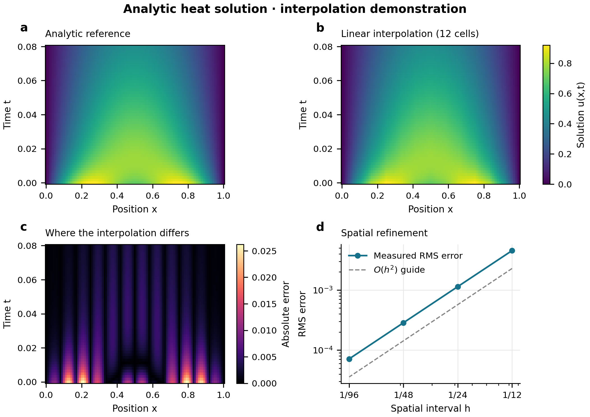

# Research-Flow-Skills

把经常重复的科研工作整理成简短、可扩展的 AI 协作流程。用户只需说明这次要做什么，AI 读取对应任务卡，按已有习惯处理。

## 目前有哪些流程

| Skill | 做什么 | 当前状态 |
| --- | --- | --- |
| [论文画图 / paper-figures](skills/paper-figures/SKILL.md) | 从论文故事和已有结果出发，自主选图、画图、看图修改、审核交接 | 有可运行演示和绘图验证 |
| [文献综述 / literature-review](skills/literature-review/SKILL.md) | 查前人、补论文引用、找生物应用和开放数据 | 初版，包含 3 张任务卡 |
| [论文写作 / paper-writing](skills/paper-writing/SKILL.md) | 从粗稿、精修到投稿、后续想法和项目交接 | 初版，包含 6 张任务卡 |
| [期刊投稿改稿 / journal-submission](skills/journal-submission/SKILL.md) | 按官网要求换模板，正式返修、逐条回复并更新原复现仓库 | 初版，含回复 LaTeX 模板 |
| [论文审稿 / peer-review](skills/peer-review/SKILL.md) | 以中性语气写具体、有依据的审稿意见 | 初版，含常用审稿 LaTeX 模板 |
| [基金写作 / grant-writing](skills/grant-writing/SKILL.md) | 先选适用 skills，再写作精修基金和可编辑 PowerPoint 技术路线图 | 初版，含写作与路线图任务卡 |
| [数学建模 / math-modeling](skills/math-modeling/SKILL.md) | 按题目完成建模、实验、论文与匿名提交整理 | 初版，含分步工作和两份交付包约定 |

先保持好用、简短，在真实任务中逐步改进。主说明只记录共用习惯，具体任务按需读取。

## 以后怎样说

> 按文献综述流程查一下这个想法，用我的中文 NoteTemplate 整理。

> 按论文写作流程精修这篇粗稿，别加工程笔记类的话。

> 按论文画图流程处理这篇论文和已有结果。选图、参考查找和审美由你决定，交付成图、代码与简短图注。

只改一个地方时也可以直接说：

> 只修改 Introduction 的第二段，保留其他内容。

在已经安装并支持选择 skill 的环境中，选择对应中文名称或英文 skill 名称。Codex 可用 $literature-review、$paper-writing、$paper-figures；其他宿主使用其支持的方式。尚未安装时，让 AI 先读取对应 SKILL.md，再按其中的链接读取任务卡。

## 文献综述：三类任务

| 任务 | 默认交付 |
| --- | --- |
| [有一个想法，查前人研究](skills/literature-review/references/idea-review.md) | 使用 NoteTemplate 的中文 LaTeX、参考文献，可编译时附 PDF |
| [为 Introduction、方法或数学结论补文献](skills/literature-review/references/manuscript-citations.md) | 直接修改论文对应段落和 Bib，默认不另写报告 |
| [为方法或理论找生物应用](skills/literature-review/references/application-search.md) | 有意思的生物问题、代表论文、开放数据入口及适配判断 |

应用优先考虑传染病动力学、生态动力学、药物动力学，高质量论文与开放数据共同服务于研究问题；不能只看期刊名气。

## 论文写作：六类任务

| 任务 | 主要约定 |
| --- | --- |
| [起草很粗的初稿](skills/paper-writing/references/first-draft.md) | 已有想法和初步结果；模板由用户决定；先写详细计划，再逐步完成 |
| [精修粗稿](skills/paper-writing/references/refine-draft.md) | 改摘要、Introduction、术语、证明、数值叙事和图，至少两轮实际审改，最后打包 |
| [整理复现仓库](skills/paper-writing/references/reproducibility-repo.md) | 整理代码、可发布数据和已有图，排除论文 LaTeX 与 TIFF；不运行项目代码 |
| [投稿前最后检查](skills/paper-writing/references/pre-submission.md) | 查文献与数学，评估创新和选刊，整理附件、Cover Letter、图片及投稿文件 |
| [往后还可以做什么](skills/paper-writing/references/next-ideas.md) | 基于真实成果与局限，用 NoteTemplate 写中文 LaTeX 研究构想 |
| [复盘与重启交接](skills/paper-writing/references/project-handoff.md) | 先只读盘点和确认版本，再生成方便数月后继续工作的指南 |

**正文和 Supplement 都要写成学术论文，别加工程笔记类的话。**围绕科学问题、方法、证据与结论来写。脚本调用、文件流转、fallback、运行日志和 AI 修订过程放在需要它们的复现文档或内部记录；模型、离散、噪声、优化参数和统计规则完整保留，用准确的学术语言表达。每轮修改都检查这一条。

**减少防御性论述。**逐句检查不必要的预防性辩解、否定式铺垫和重复免责声明。优先直接陈述研究发现，把笼统保留改为有依据的具体边界；保留必要的不确定性、研究局限与相关性／因果性区分，不增强原文结论。每轮审改都执行。

## 期刊投稿改稿与论文审稿

**期刊投稿改稿**有两个入口：[换模板](skills/journal-submission/references/change-template.md) 与 [收到意见后的返修](skills/journal-submission/references/revise-and-respond.md)。先读目标期刊当次官网要求，保留原稿和有效修改。返修逐条落实正文、附件与回复，至少两轮实际审改；已有代码、数据和结果按原仓库风格静态整理。

> 按期刊投稿改稿流程处理这次返修，在原稿基础上修改，逐条回复，最后给论文与回复、更新后的复现仓库两个压缩包。

回复使用 [response-template.tex](skills/journal-submission/assets/response-template.tex)，保留审稿人分节、Referee、Response 和 Location。具体回复以实际完成的工作和最终稿位置为依据。

**论文审稿**用于作为审稿人评价论文，使用 [review-template.tex](skills/peer-review/assets/review-template.tex)。语气中性，意见有定位和依据，重点检查数学、科学解释及证据；推荐结论按实际稿件判断。

> 用我的审稿模板审读这篇论文，语气中性，意见具体，尤其检查数学与科学解释。

两个模板由用户提供的 LaTeX 样式提炼，均为可填写的空白模板；原稿、真实审稿意见及私人信息不随模板公开。

## 基金写作与数学建模

**基金写作**先简短核查适用的基金 skills，再组织科学问题、立项依据、研究内容、研究基础和计划。当前选用 ChineseResearchLaTeX 中仍可用的写作与评审入口，以及 Humanizer-zh；具体入口见[基金资料卡](skills/grant-writing/references/resources.md)。

技术路线图用 PowerPoint 原生形状、文本和连接线制作，交付可编辑 PPTX；检查实际导出图与申请书插图尺寸下的可读性。完整申请书至少两轮评审、改稿、润色与复核。

> 按基金写作流程完善这份申请书，先选适用 skills，技术路线图用可编辑 PowerPoint 做。

**数学建模**按指定题目逐步推进：先通俗读题，再详细建模、实验、画图、成文和两轮审改。沿用用户模板与 Paper、Codes 目录，及时保存结果和进度；用户只改一段或一张图时保持局部范围。

> 按数学建模流程，只处理 A 题，沿用我提供的模板，最后给提交材料包和完整项目包。

模型要有清楚的变量、方程、目标、约束与推导；论文用学术表达，减少工程笔记和不必要防御性论述。提交材料按当届规则匿名整理，AI 使用说明据实填写；附录和实际上传格式以比赛要求为准。两个 ZIP 是交给用户的整理包，不代表赛事要求把所有文件合成一个包上传。

## 模板与外部 skills

**原作者优先，你的 fork 备用。**平时读取原作者的仓库；确认原仓库删除或确实不可用时，再使用已核实的用户备用副本。定期维护只更新备用副本，不改变来源顺序。六组来源、当前核实版本与维护方法见[外部 skills 与备用仓库](docs/skill-sources.md)。

- **中文 NoteTemplate 已随两个新 skill 提供。**使用用户原始模板，包含 Chinese 与 English 两套；独立中文综述和后续想法默认用 Chinese。见 [原模板压缩包](skills/literature-review/assets/NoteTemplate.zip) 与 [使用方法](skills/literature-review/references/notetemplate.md)。
- **期刊模板由用户指定。**[模板索引](skills/paper-writing/references/templates.md) 保存 Elsevier、PNAS、SIAM、Journal of Mathematical Biology 和 PLOS Computational Biology 的官方入口，使用时核对具体期刊与文章类型，不擅自修改 .cls。
- **按任务组合已有 skills。**[写作与研究入口](skills/paper-writing/references/optional-skills.md) 包含 Academic Research Skills、academic-writer、humanizer 与本仓库的 paper-figures。已安装就调用，可读取时按需读取；链接不等于自动安装或已运行。

## 论文画图的四步

| 步骤 | 要完成的工作 |
| --- | --- |
| 读论文和数据，理清需求 | 明确图要回答什么，已有数据能支持什么，保留已有修改。 |
| 查资料、找范例、构思图形 | 按问题读取资料、范图与适用 skills，由 AI 自主选择表达。 |
| 画图、看图、改图 | 用真实输入执行绘图，打开最终尺寸的输出并修复具体问题。 |
| 审核与交接 | 分别核对数据和图像，交付成图、可运行代码、数据指向与图注。 |

用户不需要先选出喜欢的范图，也不需要逐轮批准配色和布局。科学含义缺失时先查已有材料，再核实必要信息；只改样式时复用已有实验。

[绘图资料索引](skills/paper-figures/references/resources.md) 说明遇到什么问题该查哪里、采取什么动作、怎样检查。[可选绘图 skills](skills/paper-figures/references/optional-skills.md) 记录 Vivid Illustration、Nature Figure 和 figures4papers 的入口与使用边界。

## 安装到自己的工具

选择需要的 skill，保留其完整目录，包括 references、assets、scripts（如有）和 agents。例如选择 skills/paper-writing/：

- **Codex 项目：**把完整目录放到项目的 .agents/skills/paper-writing/。
- **Claude Code 项目：**把完整目录放到项目的 .claude/skills/paper-writing/。
- **支持从 GitHub 导入 skills 的环境：**使用本仓库，选择对应 skills/ 目录；具体入口以该工具当前支持为准。
- **普通对话：**提供主流程和相关任务卡，再提供论文、数据或其他材料。实际文件处理、绘图与编译需要相应工具能力。

仓库保存和更新流程；当前工具负责发现与执行。更新仓库后，确认安装副本也已更新。

## 看一个可以重画的例子

这里用解析热方程解的线性插值做演示，不使用私人研究数据，也不宣称新的算法成果。



输入、绘图代码与图注说明见 [演示说明](examples/README.md)。使用 Python 3.10 或更新版本，在仓库根目录运行：

```bash
python -m pip install -r requirements-demo.txt
python examples/render_demo.py
python tests/check_export.py
```

示例只重画保存的 CSV；导出辅助代码保持指定的物理尺寸，并默认保护已有输出。绘图结果仍需要人工或可看图的 AI 检查。

## 如何继续完善

先用真实任务发现具体问题，再修改相关任务卡。用户偏好与项目特例分开记录，不因为一次特殊任务不断增加通用规则。公开案例应当具有对应数据、稿件、代码和图片的发布授权。

- [开发依据与技巧](docs/skill-design.md)
- [实际验证记录](docs/validation.md)
- [绘图行为检查案例](tests/cases.md)

## 许可

本仓库的原创流程、说明、代码和演示采用 [MIT License](LICENSE)。NoteTemplate 是用户提供并授权纳入的原始模板，所依赖的 TeX 宏包与字体保留各自许可。

外部链接项目继续适用各自许可。本仓库不复制、改编或重新授权所链接的第三方 skill、代码、模板或图片，详见 [第三方来源说明](THIRD_PARTY_NOTICES.md)。
